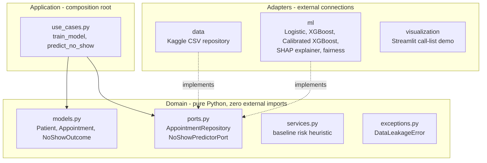
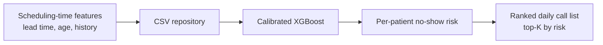
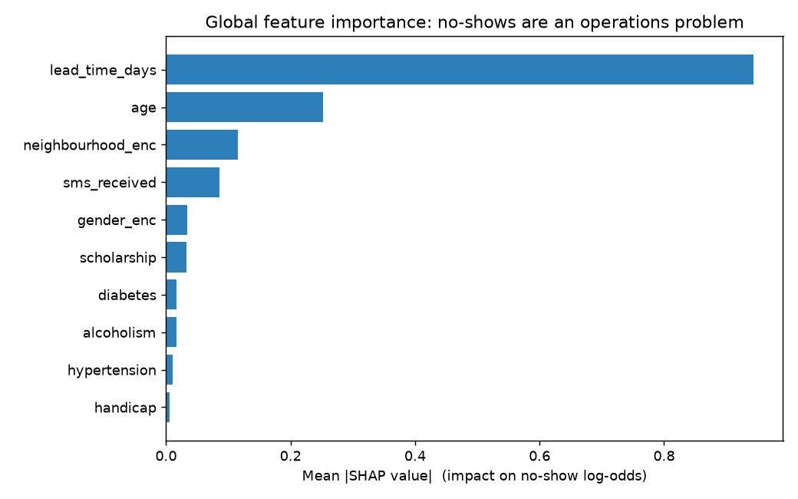
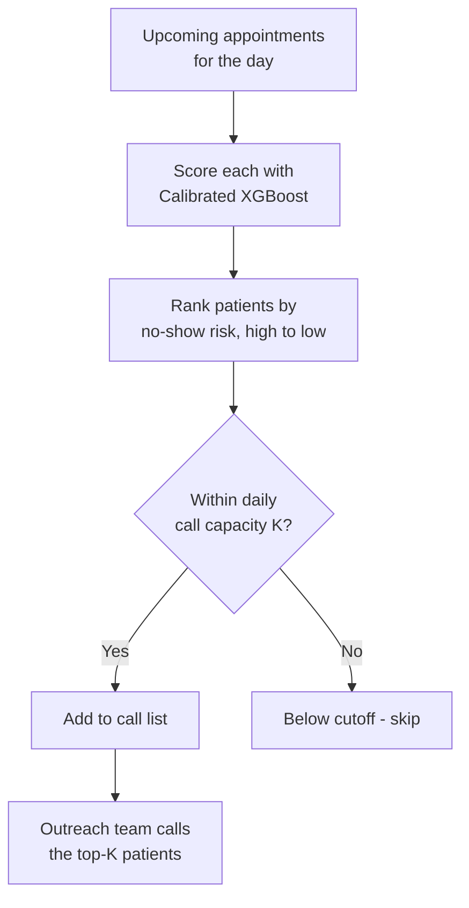

# Healthcare Appointment No-Show Predictor

Predict medical appointment no-shows at booking time so clinic outreach teams can target reminders, recover slots, and reduce revenue loss. Built with Hexagonal Architecture, calibration-focused modeling, explicit data leakage prevention, SHAP explainability, and per-slice fairness reporting.

[](https://www.python.org/downloads/)
[](./tests/)
[](https://github.com/psf/black)

> **Disclaimer:** This project uses the [Kaggle Medical Appointments](https://www.kaggle.com/datasets/joniarroba/noshowappointments) public benchmark dataset. It is not connected to any health system or employer data.

---

## Project Overview

An outreach team at a clinic wants to reduce appointment no-shows. Each morning, they need a ranked **daily call list** of patients most likely to miss their upcoming appointments, so they can proactively call and confirm or reschedule.

This system:
1. Predicts no-show probability using only **scheduling-time features** (no post-appointment data)
2. Ranks patients by risk → generates a **capacity-constrained top-K call list**
3. Explains each prediction with **SHAP**, framed as an operations problem, not a clinical one ([ADR-012](docs/adr/ADR-012-shap-narrative.md))
4. Reports **fairness** (FPR/FNR + calibration) across demographic slices ([ADR-009](docs/adr/ADR-009-fairness-reporting.md))
5. Ships an interactive **Streamlit call-list demo** ([ADR-010](docs/adr/ADR-010-streamlit-demo.md))

### Key Finding

> **"This is an operations problem, not a clinical one."** SHAP confirms it quantitatively: `lead_time_days` (mean |SHAP| 0.94) and `age` (0.25) dominate, while the clinical features (diabetes 0.016, alcoholism 0.016, hypertension 0.010, handicap 0.006) are the four *least* important of all. Same-day bookings miss about 5% of the time; next-day bookings about 21%. Scheduling practices drive no-shows far more than patient health conditions.

### Results at a glance

| What | Result |
|------|--------|
| Ranking quality (calibrated XGBoost) | AUC **0.731**, ECE **0.006** (5-fold GroupKFold); June holdout AUC **0.724** |
| Top no-show driver (SHAP) | `lead_time_days`, ~3.7x the next feature |
| Fairness | Gender parity (FPR gap 0.004). **Patients 55+ are 21% of no-shows but 0.8% of the top-20/day call list** ([ADR-013](docs/adr/ADR-013-age-disparity-at-capacity.md)) |
| Calibration within every slice | ECE ≤ 0.036 per group (≤ 0.023 per age band) |
| Call-list hit rate | **43%** of the top 20 per day really miss (vs ~18% at random), ~**8.7 slots/day** recoverable (upper bound) |
| Quality gates | **95 tests**, mypy strict, ≥75% coverage gate |

---

## Project Journey

The full pipeline is built and tested: Phase 0 through the Phase 2 explainability, fairness, and demo.

```mermaid
flowchart LR
    subgraph DONE["Built and tested - Phases 0 to 1"]
        direction LR
        J0["Domain pivot<br/>readmission to no-show<br/>ADR-001"]
        J1["EDA gate<br/>20.2 pct no-show, AUC 0.656<br/>GO decision"]
        J1b["Lead-time audit<br/>same-day vs next-day fix<br/>ADR-014"]
        J2["Leakage-safe features<br/>scheduling-time only<br/>DataLeakageError guard"]
        J3["SMS confound handled<br/>Simpson paradox, documented<br/>ADR-006"]
        J4["Validation<br/>GroupKFold by PatientId<br/>plus temporal holdout, ADR-011"]
        J5["Model lineup<br/>LogReg, XGBoost,<br/>Calibrated XGBoost"]
        J6["Calibration win<br/>Brier 0.213 to 0.144<br/>ECE 0.240 to 0.006"]
        J0 --> J1 --> J1b --> J2 --> J3 --> J4 --> J5 --> J6
    end
    subgraph PHASE2["Built and tested - Phase 2"]
        direction LR
        P1["SHAP explanations<br/>lead time and age dominate<br/>ADR-012"]
        P2["Fairness slices<br/>threshold + top-K per day<br/>ADR-009, ADR-013"]
        P3["Streamlit call-list demo<br/>ADR-010"]
        P4["Business impact model<br/>ADR-004"]
        P1 --> P2 --> P3 --> P4
    end
    J6 --> P1
```



*The full pipeline is built and tested: the domain pivot through the calibrated model, then SHAP explainability, per-slice fairness, the business-impact projection, and the Streamlit call-list demo.*

---

## Architecture

Hexagonal (Ports and Adapters), with all dependencies pointing inward toward the domain.



Data flow at prediction time:



**Layout:**

```
healthcare-noshow-predictor/
├── domain/                 # Pure Python, zero external imports
│   ├── models.py          # Patient, Appointment, NoShowOutcome
│   ├── ports.py           # AppointmentRepository, NoShowPredictorPort
│   ├── services.py        # Baseline no-show risk heuristic
│   └── exceptions.py      # DataLeakageError, domain errors
├── adapters/              # External connections
│   ├── data/              # KaggleAppointmentCSVRepository
│   ├── ml/                # Logistic, XGBoost, CalibratedXGBoost,
│   │                      #   shap_explainer, fairness, evaluation
│   └── visualization/     # call_list ranking (demo)
├── application/           # Orchestration (composition root)
│   └── use_cases.py       # train_model(), predict_no_show()
├── scripts/               # run_training, run_phase2, export_demo
├── streamlit_app.py       # Interactive call-list demo (Community Cloud)
├── demo/                  # Precomputed scored_appointments.csv for the demo
├── tests/                 # Unit + property-based (Hypothesis), 91 tests
├── notebooks/             # EDA only, no production logic
├── docs/adr/              # 12 Architecture Decision Records
└── reports/               # EDA gate, model metrics, fairness, shap/
```

**Dependency rule:** All dependencies point inward. Domain imports nothing from adapters or application.

---

## Dataset

| Property | Value |
|----------|-------|
| Source | [Kaggle Medical Appointments](https://www.kaggle.com/datasets/joniarroba/noshowappointments) |
| File | `KaggleV2-May-2016.csv` |
| Rows | 110,527 appointments (110,522 after dropping 5 impossible rows, ADR-014) |
| Patients | 62,299 unique (39% have multiple appointments) |
| Target | No-show rate: **20.2%** |
| Period | April 29 to June 8, 2016 |

**Leakage rule:** All features must be knowable at scheduling time. `DataLeakageError` raised if post-appointment features detected.

**SMS confound:** SMS_received=1 correlates with *higher* no-show rate (Simpson's paradox). SMS is sent as intervention to high-risk patients with longer lead times. Included as feature with documented caveat, not a causal predictor. See [ADR-006](docs/adr/ADR-006-sms-confound.md).

---

## EDA Gate Results

| Gate | Criterion | Result | Status |
|------|-----------|--------|--------|
| Target rate | 15 to 30% | 20.2% | ✅ |
| Logistic AUC | ≥ 0.65 | 0.6558 | ✅ |
| Feature dominance | No single >80% | max 32.9% | ✅ |
| Missing values | 0 | 0 | ✅ |
| Volume | ≥ 50k | 110,527 | ✅ |

Full report: [`reports/eda_gate.md`](reports/eda_gate.md)

---

## Model Lineup

| Model | Purpose | Identity |
|-------|---------|----------|
| Logistic Regression | Linear baseline | Interpretable, calibrated by default |
| XGBoost | Nonlinear gains | How much does tree-based modeling buy? |
| Calibrated XGBoost | Probability quality | **This project's differentiator**: isotonic calibration for ranked call lists |

**Evaluation:** AUC, F1, Brier score, precision@K, ECE (Expected Calibration Error)

**Validation:** 5-fold GroupKFold (by PatientId) + temporal holdout (June). See [ADR-011](docs/adr/ADR-011-split-strategy.md).

### Results (5-fold GroupKFold CV)

| Model | AUC | F1 | Brier | ECE | Precision@20 |
|-------|-----|-----|-------|-----|-------------|
| Logistic | 0.6605 ± 0.0050 | 0.4029 ± 0.0036 | 0.1548 ± 0.0016 | 0.0259 ± 0.0025 | 0.37 ± 0.07 |
| XGBoost | 0.7313 ± 0.0039 | 0.4480 ± 0.0040 | 0.2129 ± 0.0019 | 0.2402 ± 0.0036 | 0.50 ± 0.16 |
| **Calibrated XGBoost** | **0.7311 ± 0.0042** | **0.4471 ± 0.0033** | **0.1440 ± 0.0015** | **0.0059 ± 0.0020** | **0.53 ± 0.11** |

### Temporal Holdout (June 2016)

| Model | AUC | F1 | Brier | ECE |
|-------|-----|-----|-------|-----|
| Logistic | 0.6626 | 0.3877 | 0.1453 | 0.0344 |
| XGBoost | 0.7234 | 0.4162 | 0.2145 | 0.2570 |
| **Calibrated XGBoost** | **0.7238** | **0.4156** | **0.1367** | **0.0165** |

**Key insight:** Calibration preserves AUC (0.731) while improving probability quality. Brier drops from 0.213 to 0.144, ECE from 0.240 to 0.006. (Numbers regenerated after the ADR-014 lead-time fix; before it, AUC was 0.724 and ECE 0.007.) This matters for ranked call lists where probability ordering determines who gets called.

Full metrics: [`reports/model_metrics.json`](reports/model_metrics.json)

---

## Explainability (SHAP)

Global feature importance over 5,000 sampled appointments (mean |SHAP| on the XGBoost log-odds; isotonic calibration is monotonic, so the risk *ordering* the call list acts on is preserved). See [ADR-012](docs/adr/ADR-012-shap-narrative.md).



| Rank | Feature | Mean \|SHAP\| |
|------|---------|--------------|
| 1 | `lead_time_days` | 0.944 |
| 2 | `age` | 0.252 |
| 3 | `neighbourhood` | 0.115 |
| 4 | `sms_received` | 0.085 |
| 5 to 6 | gender, scholarship | < 0.04 |
| 7 to 10 | **diabetes, alcoholism, hypertension, handicap** | **< 0.02, the four least important** |

The clinical comorbidities are the lowest-impact features of all: the quantitative backing for the "operations, not clinical" framing. Per-patient attributions power the demo's drill-down. Beeswarm: [`reports/shap/shap_beeswarm.png`](reports/shap/shap_beeswarm.png); full data: [`reports/shap/global_importance.json`](reports/shap/global_importance.json).

---

## Fairness (per-slice)

Measured on the June holdout (n = 26,451) at **two settings**. See [ADR-009](docs/adr/ADR-009-fairness-reporting.md) and [ADR-013](docs/adr/ADR-013-age-disparity-at-capacity.md).

**1. At the setting the app uses: top 20 per day** (6 days, 120 calls)

| Age band | Share of patients | Share of no-shows | Share of the call list |
|----------|-------------------|-------------------|------------------------|
| 0-17 | 24.6% | 26.8% | 36.7% |
| 18-34 | 21.1% | 25.5% | 46.7% |
| 35-54 | 27.3% | 26.5% | 15.8% |
| **55+** | 27.0% | 21.2% | **0.8%** |

**2. Screening view: one threshold (0.22)**, F1-optimal and tuned on the June holdout itself, so slightly optimistic.

| Slice | No-show rate | FPR | FNR | ECE |
|-------|--------------|-----|-----|-----|
| Female | 0.183 | 0.438 | 0.230 | 0.019 |
| Male | 0.188 | 0.435 | 0.234 | 0.013 |
| Age 18-34 | 0.223 | 0.557 | 0.066 | 0.016 |
| Age 55+ | 0.144 | 0.244 | 0.593 | 0.021 |
| SMS received | 0.261 | 0.754 | 0.152 | 0.022 |
| No SMS | 0.127 | 0.235 | 0.354 | 0.013 |

**Findings, surfaced not hidden:**
- **Gender: balanced.** FPR gap 0.004, FNR gap 0.004.
- **Calibration holds within every slice** (ECE ≤ 0.036), not just in aggregate.
- **Age: a real disparity at the operating point.** Patients 55+ no-show less, so a raw-risk ranking almost never puts them on a short list. The scores are honest; the ranking policy is the issue. Fixing it is a policy choice (per-group capacity, equal-FNR thresholds, or benefit-based ranking) that needs clinical and equity input, so it is disclosed, not patched ([ADR-013](docs/adr/ADR-013-age-disparity-at-capacity.md)).
- **SMS gap** reflects the documented selection-effect confound ([ADR-006](docs/adr/ADR-006-sms-confound.md)).

Full report: [`reports/fairness.json`](reports/fairness.json).

---

## Daily Call List

Capacity-constrained top-K: the team states how many calls it can make, and the system returns that many highest-risk patients (ADR-005).



---

## Business Impact Model

A labeled *what-if* ([ADR-004](docs/adr/ADR-004-revenue-based-impact.md), amended 2026-10-23), led by **appointment slots**, not dollars:

```
hit rate, top 20 per appointment day (June holdout) = 0.43
recoverable slots/day   = 20 calls × 0.43          ≈ 8.7
recoverable slots/month = 8.7 × 22 working days    ≈ 191
value                   = slots × cost per slot    (editable in the app; default USD 200)
```

**Assumptions labeled, not hidden:** this is an upper bound that assumes every correctly-flagged, called patient keeps or rebooks their slot. The default cost is a US primary-care literature estimate, not clinic data. An earlier version used the top 20 across the whole holdout week (0.55), which overstated the per-day hit rate. Full data: [`reports/business_impact.json`](reports/business_impact.json).

---

## Interactive Demo

A six-tab Streamlit app (plain language first): **Start here**, a **daily call list** (pick a day + call capacity K), a **SHAP drill-down** per patient, **fairness** at the call-list setting, **impact** in appointment slots, and **how we built it**, all from precomputed artifacts, so it needs no model training or raw data at runtime.

```bash
pip install -e ".[demo]"
streamlit run streamlit_app.py
```

*Live demo: deploying to Streamlit Community Cloud (URL to follow).* Regenerate the artifacts with `python scripts/run_training.py && python scripts/run_phase2.py && python scripts/export_demo.py`.

---

## Technology Stack

| Category | Tools |
|----------|-------|
| Language | Python 3.12+ |
| ML | scikit-learn, XGBoost |
| Explainability | SHAP (TreeExplainer) |
| Demo | Streamlit (Community Cloud) |
| Testing | pytest, Hypothesis (property-based), 95 tests |
| Quality | black, isort, mypy (strict), ruff, pre-commit |
| CI | GitHub Actions (lint, test, security) |

---

## Setup

```bash
git clone https://github.com/tirthjoship/healthcare-noshow-predictor.git
cd healthcare-noshow-predictor
pip install -e ".[dev,analysis,demo]"
pre-commit install

# Place dataset
# Download from Kaggle → data/raw/KaggleV2-May-2016.csv

# Run tests + full quality check
make test
make check

# Regenerate Phase 2 artifacts (SHAP, fairness, business impact) + demo data
python scripts/run_phase2.py
python scripts/export_demo.py

# Launch the interactive demo
streamlit run streamlit_app.py
```

---

## Project Status

| Phase | Description | Status |
|-------|-------------|--------|
| 0 | EDA gate: dataset validation | ✅ PASSED |
| 0.5 | Domain pivot: readmission to no-show | ✅ Complete |
| 1 | Adapters + model training | ✅ Complete (3 models) |
| 2 | SHAP, fairness, business impact | ✅ Complete |
| 2.5 | Streamlit call-list demo | ✅ Built (Community Cloud deploy pending) |

**91 tests** total (unit + property-based), mypy strict, 81% coverage.

---

## Architecture Decision Records

14 ADRs in [`docs/adr/`](docs/adr/). The full story, level by level, is in [`docs/DECISION_TREE.md`](docs/DECISION_TREE.md).

| ADR | Decision |
|-----|----------|
| [001](docs/adr/ADR-001-pivot-to-noshow.md) | Pivot from readmission to no-show |
| [002](docs/adr/ADR-002-primary-persona.md) | Primary persona: outreach team |
| [003](docs/adr/ADR-003-daily-call-list.md) | Daily call list intervention |
| [004](docs/adr/ADR-004-revenue-based-impact.md) | Impact model; amended: slots first, per-day precision |
| [005](docs/adr/ADR-005-capacity-constrained-topk.md) | Capacity-constrained top-K threshold |
| [006](docs/adr/ADR-006-sms-confound.md) | SMS confound documentation |
| [007](docs/adr/ADR-007-target-encoding.md) | Target encoding (train-only) |
| [008](docs/adr/ADR-008-model-lineup.md) | Logistic → XGBoost → Calibrated XGBoost |
| [009](docs/adr/ADR-009-fairness-reporting.md) | FPR/FNR + calibration per slice; amended: capacity view, neighbourhood slice |
| [010](docs/adr/ADR-010-streamlit-demo.md) | Streamlit demo; amended: 6 plain-language tabs |
| [011](docs/adr/ADR-011-split-strategy.md) | GroupKFold + temporal holdout |
| [012](docs/adr/ADR-012-shap-narrative.md) | "Operations, not clinical" framing |
| [013](docs/adr/ADR-013-age-disparity-at-capacity.md) | 55+ under-served by raw-risk call list: disclose, don't patch yet |
| [014](docs/adr/ADR-014-lead-time-calendar-days.md) | Lead time = calendar days; drop impossible rows |

---

## Limitations

- **Public benchmark data**: not production clinical data
- **SMS confound**: SMS_received coefficient is not causal (Simpson's paradox)
- **Narrow time window**: dataset covers ~6 weeks (April to June 2016)
- **Single clinic system**: Vitória, Brazil; may not generalize to other geographies
- **No cost optimization**: threshold is capacity-based, not cost-optimized
- **Raw-risk ranking under-serves older patients** (ADR-013): disclosed, not patched; needs a policy decision
- **Short holdout**: June covers 6 days, so per-day results rest on small samples

---

## Author

**Tirth Joshi**
UBC Master of Data Science
Former Data Systems Analyst, VGH & UBC Hospital Foundation

---

## License

MIT License. See [`LICENSE`](LICENSE) for details.
