# Decision Tree: from raw data to the shipped app

**What this is:** every finding and decision in this project, in the order they happened, each in plain English and in scientific terms, linked to the ADR that records it.
**Why it exists:** so that anyone (including future me) can reopen this project months later and see *what we saw, what we decided and why* without rereading the code.
**Last updated:** 2026-10-23 (Phase 2 ship-safe audit). Newer levels get appended. Superseded decisions are marked, never deleted.

---

## The tree at a glance

```mermaid
flowchart TD
    L0["L0 Problem<br/>Outreach teams can only make a few calls a day<br/>Who to call first?"]
    L0 -->|"ADR-001/002/003"| L1

    L1["L1 Data quality<br/>110,527 rows, 0 nulls<br/>34.9% lead times look negative"]
    L1 -->|"First read (May 2026): 'data errors', clip to 0"| L1a["Clip to 0<br/>SUPERSEDED"]
    L1 -->|"Audit (Oct 2026): they are same-day bookings"| L1b["Calendar-day lead time<br/>drop 5 impossible rows<br/>ADR-014"]

    L1b --> L2["L2 Exploration<br/>No-show rate 20.2%<br/>Same-day 4.6% vs next-day 21.4%<br/>SMS linked to MORE no-shows"]
    L2 -->|"Selection effect, not cause"| L2a["Keep SMS, document confound<br/>ADR-006"]

    L2a --> L3["L3 Validation design<br/>39% of patients book more than once"]
    L3 -->|"Avoid patient leakage + test the future"| L3a["GroupKFold by patient<br/>+ June temporal holdout<br/>ADR-011"]

    L3a --> L4["L4 Encoding<br/>81 neighbourhoods"]
    L4 -->|"Target encoding fit on train folds only"| L4a["ADR-007"]

    L4a --> L5["L5 Models<br/>Logistic AUC 0.66<br/>XGBoost AUC 0.73 but ECE 0.24"]
    L5 -->|"Keep the ranking, fix the probabilities"| L5a["Calibrated XGBoost<br/>AUC 0.73, ECE 0.006<br/>ADR-008"]

    L5a --> L6["L6 Explanation<br/>SHAP: lead time >> age >> neighbourhood<br/>clinical features near zero"]
    L6 -->|"Frame as operations, not clinical"| L6a["ADR-012"]

    L6a --> L7["L7 Fairness<br/>Calibrated within every group<br/>but 55+ = 0.8% of the call list"]
    L7 -->|"Policy choice, needs clinical + equity input"| L7a["Disclose now, review before real use<br/>ADR-009 amended, ADR-013"]

    L7a --> L8["L8 Delivery<br/>Top-20 per day, hit rate 43%"]
    L8 -->|"Slots first, dollars editable"| L8a["~8.7 slots/day<br/>ADR-004 amended, ADR-005"]

    L8a --> L9["L9 Shipping<br/>CI missing shap<br/>App = 6 plain-language tabs"]
    L9 --> L9a["Streamlit Community Cloud<br/>ADR-010 amended"]

    L9a --> V2["v2 open questions<br/>see bottom of this file"]

    classDef superseded fill:#eee,stroke:#999,color:#777,stroke-dasharray: 4 3
    class L1a superseded
```

---

## Level by level

### L0. Problem framing

| | |
|---|---|
| **What we saw** | A public dataset of 110K medical appointments (Vitória, Brazil, Apr to Jun 2016) with a no-show label. The original plan (hospital readmission on MIMIC) was blocked by data access. |
| **Plain English** | Clinics lose appointment slots when patients don't show up. A reminder call helps, but staff can only make a few calls. So the useful output isn't "will this person miss?" but "**who should we call first today?**" |
| **Scientific** | Framed as a ranking problem under a capacity constraint (top-K per day), not plain classification. That makes ranking quality (AUC, precision@K) and probability calibration the key metrics, rather than accuracy. |
| **Decision** | Pivot to no-shows. Persona = outreach team. Output = daily call list of the top K. |
| **Records** | [ADR-001](adr/ADR-001-pivot-to-noshow.md), [ADR-002](adr/ADR-002-primary-persona.md), [ADR-003](adr/ADR-003-daily-call-list.md), [ADR-005](adr/ADR-005-capacity-constrained-topk.md) |

### L1. Data quality

| | |
|---|---|
| **What we saw** | 110,527 rows, 14 columns, zero nulls. 1 negative age, 7 ages over 100. **34.9% of lead times were negative.** |
| **First decision (May 2026, superseded)** | Treated the negatives as data errors and clipped them to 0. |
| **What the Oct 2026 audit found** | `AppointmentDay` is always midnight; `ScheduledDay` has a time. Same-day bookings came out as −1. Next-day bookings came out as 0. Every other gap was one day short. Only **5** rows were truly impossible (appointment before booking). |
| **Plain English** | We had mistaken the most useful group of rows (same-day bookings, which almost always show up) for broken data, and merged them with next-day bookings, which miss far more often. |
| **Scientific** | Systematic measurement error in the top predictor, caused by mixed timestamp precision. Fixing it **improved** discrimination (CV AUC 0.7237 → 0.7311), consistent with attenuation from a noisy feature. |
| **Decision** | Lead time = calendar-day difference. Drop the 5 impossible rows. Regression tests. Regenerate everything. |
| **Lesson** | Before calling values "impossible", check how they were measured. |
| **Records** | [ADR-014](adr/ADR-014-lead-time-calendar-days.md) |

### L2. Exploration

| | |
|---|---|
| **What we saw** | No-show rate 20.2%. Same-day bookings 4.6%, next-day 21.4%, 2+ days 24 to 33% (29% overall). Gender makes little difference. Younger adults miss most. **Patients sent an SMS missed more** (27.6% vs 16.7%). SMS patients had much longer lead times (mean 19.0 vs 6.0 days). |
| **Plain English** | SMS reminders weren't causing no-shows. The clinic sent them to appointments booked far ahead, which were already riskier. |
| **Scientific** | Confounding by indication / selection effect (a Simpson's-paradox pattern): treatment assignment depends on a risk factor. The SMS coefficient is predictive, not causal. |
| **Decision** | Keep SMS as a feature (it is known before the appointment), and document it everywhere as non-causal. |
| **Side note** | In the baseline logistic regression, SMS had the largest coefficient and lead time one of the smallest. That's because raw coefficients depend on units (lead time is in days; SMS is 0/1), so they aren't comparable importance measures. SHAP (L6) is. |
| **Records** | [ADR-006](adr/ADR-006-sms-confound.md), [`reports/eda_gate.md`](../reports/eda_gate.md) |

### L3. Validation design

| | |
|---|---|
| **What we saw** | 62,299 unique patients; **39%** have more than one appointment. Data covers April to June 2016. |
| **Plain English** | If the same patient appears in both training and testing, the model can "recognise" them and look better than it really is. And a model should be tested on the future, not only on shuffled past data. |
| **Scientific** | Group leakage → GroupKFold by PatientId (5 folds). Temporal generalisation → train April to May, test June. |
| **Decision** | Report both. |
| **Caveat found later** | The June holdout only covers **6 days** (the data ends June 8), so per-day results rest on small samples. |
| **Records** | [ADR-011](adr/ADR-011-split-strategy.md) |

### L4. Encoding

| | |
|---|---|
| **What we saw** | 81 neighbourhoods, a long tail of small ones. |
| **Plain English** | Replace each neighbourhood name with its historical no-show rate, but only learn that rate from training data, so the test data never leaks in. |
| **Scientific** | Target encoding fit within training folds only. |
| **Records** | [ADR-007](adr/ADR-007-target-encoding.md) |

### L5. Models

| | |
|---|---|
| **What we saw** | Logistic regression AUC 0.66. XGBoost AUC 0.73 (better ranking), but its probabilities were badly off (ECE 0.24). |
| **Plain English** | XGBoost was better at putting risky patients at the top, but its percentages couldn't be trusted ("30%" didn't mean 30%). Calibration fixes the percentages without changing the order. |
| **Scientific** | Isotonic calibration on XGBoost: AUC unchanged (0.7311), ECE 0.240 → **0.006**, Brier 0.213 → 0.144 (5-fold). June holdout AUC **0.724**. Precision@20 has wide spread (±0.11), because 20 is a small sample. |
| **Decision** | Ship calibrated XGBoost; keep logistic as the baseline. |
| **Records** | [ADR-008](adr/ADR-008-model-lineup.md), [`reports/model_metrics.json`](../reports/model_metrics.json) |

### L6. Explanation

| | |
|---|---|
| **What we saw** | Mean absolute SHAP: lead time 0.94, age 0.25, neighbourhood 0.11, SMS 0.09. Diabetes, hypertension, alcoholism and disability all ≤ 0.02. |
| **Plain English** | **It's a scheduling problem, not a medical one.** How far ahead people book matters far more than their health conditions. That's good news, because scheduling is something a clinic can change. |
| **Scientific** | Global SHAP (TreeExplainer, 5,000-row sample, log-odds space). Per-patient SHAP in the app. |
| **Records** | [ADR-012](adr/ADR-012-shap-narrative.md) (ADR-012 planned SMS 3rd; measured, neighbourhood is 3rd. After ADR-014, lead time's mean \|SHAP\| rose 0.84 → 0.94) |

### L7. Fairness

| | |
|---|---|
| **What we saw** | Calibration holds in every group (ECE ≤ 0.036 in all slices). Gender is balanced. But at the app's operating point (top 20 per day), **patients 55+ are 21% of no-shows and 0.8% of the call list.** At the 0.22 threshold their miss rate (FNR) is 59% vs 7% for ages 18 to 34. |
| **Plain English** | The model is right that each older patient is less likely to miss. But "call the riskiest 20" then means older patients almost never get called, even though they make up a fifth of the missed appointments. |
| **Scientific** | Base-rate differences + a single global ranking → unequal capture (recall) across groups, even with group-wise calibration. A known tension: calibration within groups and equal error rates can't generally hold at the same time when base rates differ. The threshold view was tuned on the holdout itself (optimistic), so the capacity view is the primary evidence. |
| **Decision** | Disclose prominently; **no patch now**. Fixing it means choosing a policy (per-group capacity, equal-FNR thresholds, or benefit-based ranking), and that needs clinical and equity input. |
| **Records** | [ADR-009](adr/ADR-009-fairness-reporting.md) (amended), [ADR-013](adr/ADR-013-age-disparity-at-capacity.md) |

### L8. Delivery and impact

| | |
|---|---|
| **What we saw** | At top-20 per day, **43%** of called patients really were going to miss (vs about 18 to 20% at random). The first impact estimate used the top 20 over the whole test week (55%), which overstated it. |
| **Plain English** | About 9 of every 20 calls reach someone who would have missed, so roughly **8.7 slots a day** could be saved, at most. |
| **Scientific** | Precision@K per day ≈ 0.43 (6 days, 120 calls; 0.43 to 0.45 depending on how tied calibrated scores at the cutoff are ordered). Slots = K × precision × 22 working days ≈ 191/month. Dollars = slots × an editable cost (default USD 200, literature estimate). Upper bound: assumes every reached patient keeps or rebooks. |
| **Decision** | Slots first, dollars as an editable assumption. |
| **Records** | [ADR-004](adr/ADR-004-revenue-based-impact.md) (amended), [ADR-005](adr/ADR-005-capacity-constrained-topk.md) |

### L9. Shipping

| | |
|---|---|
| **What we saw** | PR #7's CI failed: CI installed only the `dev` extra, and `shap` lives in `analysis`. (Tests passed locally because shap was installed there.) |
| **Decision** | CI installs `.[dev,analysis]`. The app has 6 tabs with plain language first and renders only precomputed artifacts (no raw data or training at runtime). |
| **Records** | [ADR-010](adr/ADR-010-streamlit-demo.md) (amended) |

---

## v2 open questions (fresh-EDA track, from about 2026-10-27)

1. **Is K = 20 a realistic framing?** The data is a whole city system (about 4,400 appointments a day in June), so 20 calls reach about 1% of no-shows. Per-clinic or per-neighbourhood lists may be more realistic.
2. **Fairness policy:** what does it cost (in hit rate) to reserve call capacity by age band?
3. **Benefit vs risk:** rank by who a call would *help*, not just who is risky. That needs intervention data; the SMS confound shows why it can't be inferred from this dataset.
4. **Threshold selection** on a validation month, not the test month.
5. **Longer holdout:** the June window is only 6 days.
